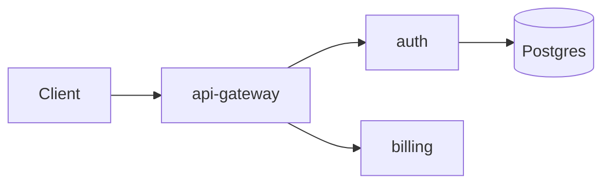
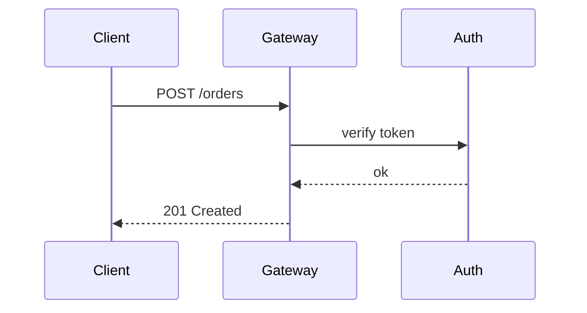

# Gateway rollout v2.4

The **api-gateway** moves to `v2.4.1` on *Friday*. ==Freeze starts at 16:00.== Press <kbd>Ctrl</kbd>+<kbd>C</kbd> to abort a run; see the [runbook](https://github.com/acme/gw/wiki/runbook) and the note[^why].

## Changes

- [x] Retry budget per route
- [x] OpenTelemetry spans for upstream calls
- [-] gRPC passthrough (moved to v2.5)
- [ ] Load test at 3× peak

> [!NOTE]
> Canary runs for **30 minutes** before promotion.

> [!TIP]
> Use `--dry-run` first on a shared cluster.

> [!IMPORTANT]
> Database migrations run before the deploy, never after.

> [!WARNING] Freeze window
> No deploys after 16:00 on Friday.

> [!CAUTION]
> Never skip the schema check.

### Retry handler

```typescript
export async function withRetry<T>(call: () => Promise<T>, budget = 3): Promise<T> {
  for (let attempt = 1; ; attempt++) {
    try {
      return await call()
    } catch (error) {
      if (attempt >= budget) throw error // give up: budget spent
      await sleep(2 ** attempt * 100)
    }
  }
}
```

```python
@dataclass(frozen=True)
class Route:
    path: str
    retries: int = 3

    def backoff(self, attempt: int) -> float:
        return min(30.0, 0.1 * 2 ** attempt)  # seconds
```

```rust
fn parse_port(raw: &str) -> Result<u16, String> {
    raw.parse::<u16>().map_err(|e| format!("bad port {raw}: {e}"))
}
```

```go
func (s *Server) Healthz(w http.ResponseWriter, r *http.Request) {
	w.WriteHeader(http.StatusOK)
	fmt.Fprintf(w, "ok %s\n", s.version)
}
```

### Config

```yaml
gateway:
  replicas: 3
  routes:
    - path: /api/v1/orders
      retries: 3
      timeout: 2s
```

```sql
SELECT route, count(*) AS errors
FROM requests
WHERE status >= 500 AND ts > now() - interval '1 hour'
GROUP BY route
ORDER BY errors DESC;
```

```diff
-  timeout: 5s
+  timeout: 2s
+  retries: 3
```

```bash
kubectl -n edge rollout status deploy/api-gateway --timeout=10m
```

## Status

| Service | Replicas | p99 | Status |
| :--- | ---: | ---: | :---: |
| api-gateway | 3 | 182 ms | **ok** |
| auth | 2 | 340 ms | *degraded* |
| billing | 4 | 95 ms | ok |

Error budget: $\frac{1 - 0.999}{30} \approx 3.3 \times 10^{-5}$ per day.

$$
P(\text{fail}) = 1 - \prod_{i=1}^{n} (1 - p_i)
$$

> Roll back if p99 rises above **300 ms**.
>
> > Ask in #edge-oncall first.

[^why]: The canary catches config drift before prod does.

### Request path






fixture-end
